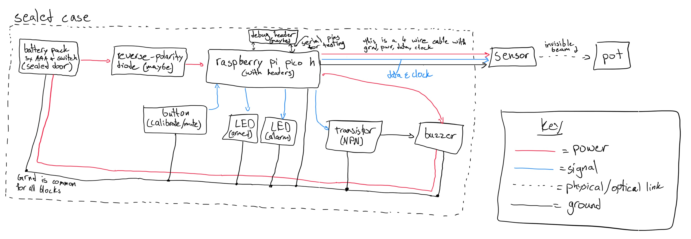
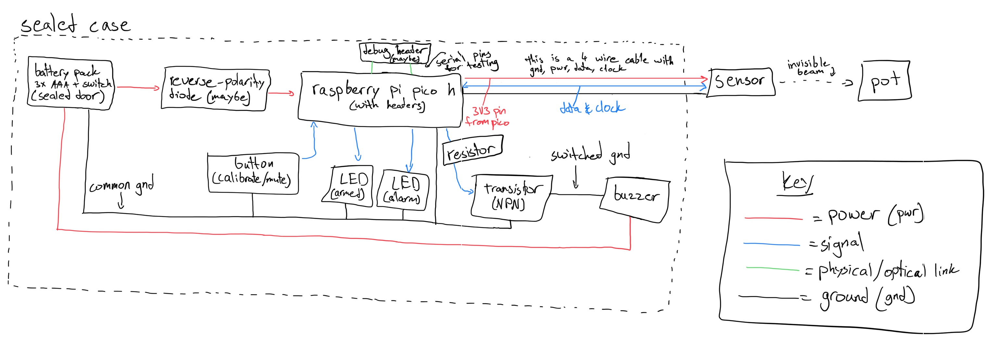
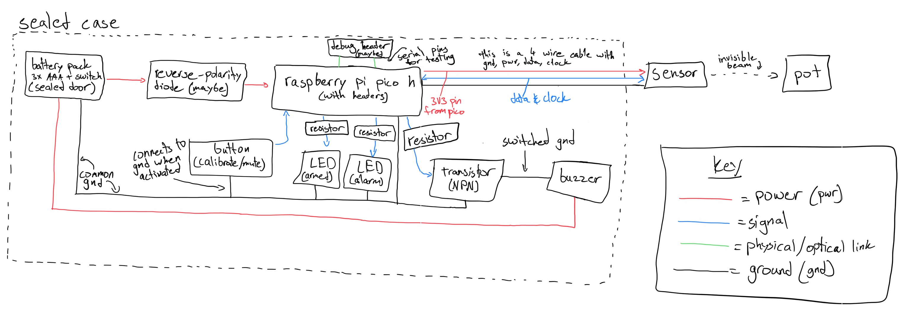

## October 19, 2026: Analyzing the project and restrictions, setting up and planning project, researching

Today I was taking the first measurements of the target default pot, the pot handle, the depth of this pot, and other measurements that I can use later for reference when designing the product and its case. Because the pot's handle is higher than the near side pot rim, I am able to mount the device on the handle of the pot. There is also a convenient hole in the pot's handle which I may possibly use to my advantage. The pot also has a shiny reflective material, which might show bad readings for the laser.

I also do not know how to solder, which is required for this project as it will mostly be through-hole soldering. So, I am going to learn how to solder! I have watched many YouTube videos (not included in the time below) to help me learn more about soldering. My learning is explained with the picture below. The solder tin is the actual substance that connects the two components and electrically conducts them. The solder tip must be touched to the two components that are being soldered together, then add in the solder tin for the solder to properly melt on the components. I also read this [article](https://www.ifixit.com/News/6864/how-to-solder) from iFixit (counted in below time spent) to learn more about soldering.

For the actual project, I plan for this to be mainly for an audience who does not like to constantly sit at the stove waiting for their dish to boil. Instead, with this product, they can go sit down and do something fun while waiting for their dish to boil, all without having to worry about the dish overflowing and spilling all over the stove. I plan for this project to have a Tier 3 grant cap and mostly through-hole solder joints because I am still a beginner. I do not plan to use an expensive Raspberry Pi and also plan to use eye-safe lasers only to ensure the customer's safety.

While brainstorming about how I thought this project would work out, I first thought that I would clip the whole device onto the rim and have some little liquid sensor pins drip into the pot. I realized this would be very inconvenient for the customer to have to always wash the pins each time they make a new dish, as the pins are directly into the food. Moreover, the extreme heat from the stove, pot, and steam coming off of it, is too dangerous for electronics so I decided I needed to move it somewhere else. I thought about a large arm over the pot, dripping pins into the pot but I realized this is also retains the same inconvenient design with the pins and it is also very bulky. Then I came to the idea of a wireless design with a camera pointing at the pot. This would remove the inconvenience of the pins and introduce an entirely new aspect of viewing the pot. However, this design would require an AI model to process the video and detect if it is about to overflow or not. This design requires too much compute power and also raises a privacy concern with the camera. Then finally I came to the main idea of a laser on the handle. This would remove the inconvenience of the pins, remove the privacy concerns and excessive compute power of a camera detection device, and it would result in a cleaner design overall.

Although this project can greatly help a customer with cooked, I cannot advertise it as a safety device, but instead as a tool. This is because the detection of the overflow is not necessarily guaranteed due to the different designs of pots and also sometimes a glitch can occur. However, this is a very useful tool and would save customers a lot of waiting around and doing nothing!

**Total time spent: 1h**

## October 23, 2026: Block diagram model and some part selection/organization with more researching

The main thing I did today was make a diagram of the project that I plan to make with some of the parts that I think I might use. I described and visualized the flow of power and signals also illustrated which components the ground cables will run to and some of the physical links or optical (like laser beam) links. In the diagram, all of the blocks use the same ground bus because this will allow the current to have somewhere to flow back to the battery. From my research, I discovered a reverse-polarity diode ensures that current does not flow backward to the batteries which is optional in my diagram to add depending on the voltage drop and where it will sit. The Raspberry Pi Pico H is going to be the main brain for the whole program. The chip is the RP2040 with two processor cores clocking up to 133 MHz, 264 KB of memory, and 2 MB of storage. This micro-controller also has 26 GPIO pins for the button, LEDs, transistor, and buzzer. The button will be the only user input source for the device. I am still deciding on the input methods, which I will do once I make the firmware. There are two LEDs, one that notifies the user that the device is armed and actively detecting for overflow, and one that flashes when the alarm is going off. There is also an optional debug header which I might add in. I have thought about this debug header because, when the PCB is sealed inside the case (because it has to be somewhat liquid proof), it will be hard to reach the Pico's USB port, so I decided to add this quick debug header to help me during the building process and testing phase. The buzzer will be the small disk that vibrates loud enough to be the alarm when power is inputted into it. For the buzzer to sound loud enough, it needs an electricity voltage of 3-5V but the Pico's power pins only supply a 3.3V. Additionally, the more power that enters the buzzer, the louder it will be, so we should not bottleneck the buzzer's ability at only 3.3V, and instead take a direct line from the battery. To add on to this, since the buzzer has bursts of current, it could make the Pico's power supply vibrate, which is also used by the Pico's chip and the sensor. So, to fix all of this, I made it so that the buzzer gets its power directly from the batteries, so that it gets sufficient power to be loud enough and also it will not disturb the power supply of the Pico. I also included a transistor in between the Pico and the buzzer to control the buzzer and its current. The transistor will block the ground line for the buzzer to break the electrical loop, causing the buzzer to no longer buzz. When needed, the transistor will open back up the ground line for the buzzer (on command from the Pico) and the buzzer will start to buzz.

For one of my early diagram drawings, I had shown that the buzzer was to be powered directly by the Pico, instead of using its own power source coming directly from the battery. This would not have been very optimal because as I said before, the buzzer would not ring well with the 3.3V power coming from the Pico. I had researched that the power directly influences how high the volume of the buzzer would be, after which I then proceeded to change the design to make it take power from the batteries directly. I had also originally made the buzzer directly wired to ground, while having the transistor also wired to ground, just a little bit before the buzzer on the wire. I did some research on this and then realized that the transistor could not do anything to the buzzer, and the buzzer would just ring infinitely when given power, as the transistor cannot break the electrical loop. So I then labeled a switched ground line between the transistor and the buzzer so that the transistor could now actually control the electrical loop of the buzzer.

Although I fixed many things in this new version of my diagram, it is still not completely fixed, and has more room for improvement. Although there is a resistor between the transistor and the Pico, the LEDs still remain without resistors. This causes the LEDs to burn out due to the high amount of electricity coming from the Pico to the LEDs. So to fix this, we must place resistors between the LEDs. We can also label that the button connects to the ground line when it is activated to start the electrical loop for clarity to the reviewer. When the button starts off, it is starting with a high voltage of 3.3V with the pull-up resistor in the Pico's GPIO pin. When the button is pressed and it connects to ground, the button links the pin to 0V, which has the pin read a low voltage. The firmware watches this pin for a high voltage when it is not pressed and a low voltage when it is pressed.

With the final diagram done (below), all the components and their connections are clearly shown. During this time period of 3 hours, I spent my time first researching how I should structure this PCB and how all the individual components work, how the power flows, how the transistors, resistors, buttons, diodes, batteries, LEDs, and buzzer works and all their special requirements and properties. For example, the battery cannot be charged, the LEDs cannot receive too much electricity, the button connects a Pico pin to ground while not running on electricity, the resistors control the electricity flow towards each component so that components like LEDs can be protected, the transistor is a switch that something like the Pico can control it (unlike the resistor which cannot be controlled), and the diode that I have called the reverse-polarity diode can prevent power from going backwards to the battery and unintentionally charging it. During this session, I have gained a lot of knowledge and am very proud of myself for all this new knowledge I gained!

**Total time spent: 3h**